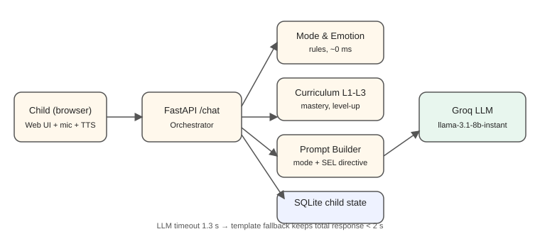
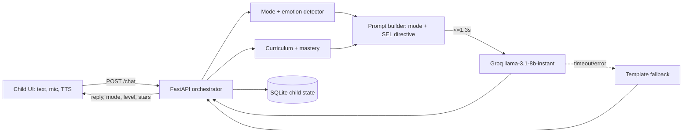

# System Design – Buddy, English for Kids (age < 7)

## 1. Goals
Teach English to under-7s step by step (L1→L3), notice *how the child is doing* (not only what they typed),
support emotions (SEL), remember progress, and answer in **< 2 s** end to end.

## 2. Architecture

Request flow: load child state → detect name/mode/emotion → (if learning) grade the last answer, update mastery,
maybe level-up → pick next item → build mode-specific directive → LLM (hard timeout) or fallback → save → respond.

## 3. Requirement mapping
| Requirement | Design |
|---|---|
| Progressive L1/L2/L3 | `curriculum.py`: L1 words → L2 short phrases → L3 sentences/questions. An item is *mastered* after 2 correct answers; 4 mastered items unlock the next level. The least-mastered item is chosen next (light spaced repetition). |
| Child-mode detection | `modes.py`, priority **SUPPORT > ENGAGEMENT > CONVERSATION > LEARNING**. Emotion words (sad, scared, angry, frustrated, tired, bored) and intent words (play, teach) pick the mode. A **drill-streak limit (3)** forces a fun break, so Buddy does not teach every turn. |
| SEL | Emotion → dedicated directive: name the feeling, validate, calm breathing, "tell a trusted grown-up", growth-mindset praise ("mistakes help us grow"). No teaching while the child is upset. Stars reward effort. Curiosity via open questions and games. |
| Context-aware | Per-child state (name, level, mastery, attempts, last emotion, last 6 turns) is persisted and injected into every prompt. |
| < 2 s latency | Detection and grading are rule-based (< 5 ms). One small LLM call (`max_tokens=70`, 8B model on Groq, typically 200–500 ms) with a **1.3 s timeout**, keep-alive HTTP client, and an instant template fallback. Each response reports `latency_ms`. |
| Safety | System prompt forbids asking for personal info; 2-sentence limit; simple vocabulary; SUPPORT mode points frightened children to a trusted adult; input length capped at 300 chars. |

## 4. Key decisions and trade-offs
- **Hybrid, not pure LLM.** Rules decide *mode, grading, level*; the LLM only *phrases* the reply. This makes progress
  deterministic, testable and fast, and it cannot be talked into skipping levels. Trade-off: keyword emotion
  detection misses subtle phrasing → a tiny classifier or LLM tagging could be added later.
- **Small model (llama-3.1-8b-instant).** Chosen for speed and cost; trade-off is weaker nuance than 70B models. The model
  name is an env var, so it can be swapped (Groq retired `gemma2-9b-it`).
- **FastAPI + vanilla HTML.** Minimal moving parts, one deployable service, no build step. Trade-off: no rich animations.
- **SQLite.** Simple, zero setup. On free hosting the disk is ephemeral, so progress resets on redeploy; use Postgres/Redis for production.
- **Browser speech (Web Speech API).** Free and instant TTS/STT (kids can't type well). Trade-off: quality/support varies by browser.
- **Lenient grading.** Token overlap (plurals tolerated) because young learners' speech-to-text is noisy; pronunciation scoring is out of scope.

## 5. Limits and future work
Parent dashboard, phoneme-level pronunciation scoring, richer content (Level 4+), streaming responses, per-child safety
logging with parental consent (COPPA/GDPR-K), classifier-based emotion detection, A/B tests for retention.

## 6. Testing
`pytest` covers mode detection, name extraction, grading, a full flow (conversation → learning → support → level-up) and the latency budget in fallback mode.
